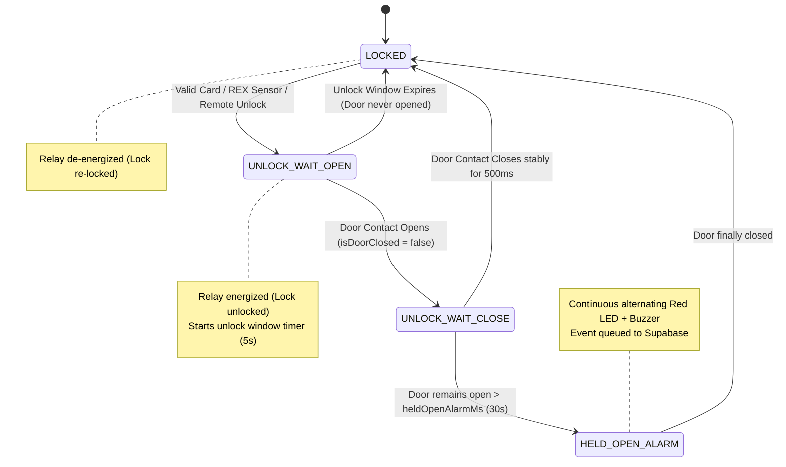
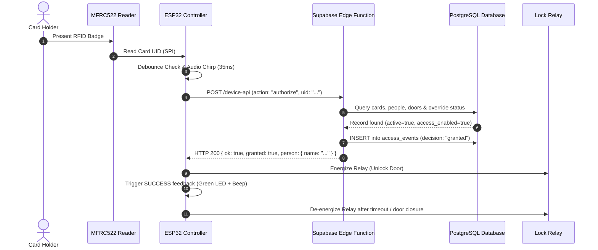
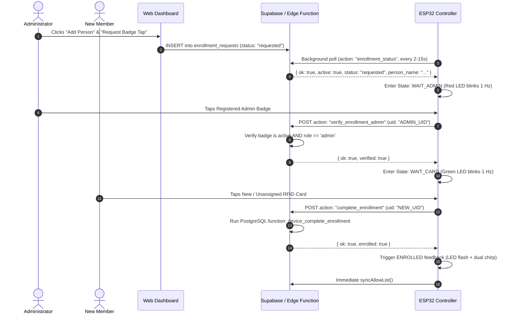

# ESP32 RFID Door Access System — System Architecture & Functioning Guide

This document provides a comprehensive technical breakdown of the RFID Door Access Control System, detailing the ESP32 firmware operations, multi-device hardware interfacing, cloud backend communication, offline resilience, and operational workflows.

---

## 1. High-Level System Architecture

The system is organized into three distinct tiers: **Edge Hardware**, **Cloud Backend & Security**, and the **Web Administration Dashboard**.

```mermaid
flowchart TB
    subgraph HardwareTier["Physical / Hardware Layer (Door Enclosure)"]
        direction TB
        subgraph ESP32Main["Main Entry Controller (ESP32 DevKit V1)"]
            ESP_CORE["ESP32 Core & State Machine"]
            MFRC522["MFRC522 RFID Reader (SPI)"]
            FC51["FC-51 IR Proximity Sensor (Touchless REX)"]
            REED["Magnetic Door Contact (Reed Switch)"]
            INDICATORS["Feedback: Red/Green LEDs & Buzzer"]
            RELAY_DRV["BC547 Level Shifter & 5V Relay"]
            LITTLEFS["LittleFS Local Cache (/allow-list.json & /events.ndjson)"]
        end

        subgraph AuxBoards["Auxiliary Wireless Nodes (Optional ESP8266/NodeMCU)"]
            EXIT_NODE["Inside Exit Reader NodeMCU\n(MFRC522 + Handshake Out)"]
            REMOTE_NODE["Remote Unlock NodeMCU\n(Polls Cloud + Handshake Out)"]
        end

        STRIKE["12V DC Fail-Secure Electric Strike\n+ 1N4007 Flyback Diode"]
        DIODE_OR["Diode-OR Bus (Dual 1N4148)"]
    end

    subgraph CloudTier["Cloud Backend Layer (Supabase)"]
        EDGE_FN["Supabase Edge Function: /functions/v1/device-api\n(Deno / TypeScript)"]
        DB[("PostgreSQL Database\n- cards & people\n- devices & doors\n- access_events\n- enrollment_requests")]
        REALTIME["Supabase Realtime Engine"]
    end

    subgraph AdminTier["Management & Admin Layer"]
        WEB_DASH["Web Admin Dashboard (Vite + TypeScript)"]
        ADMIN_USER["System Administrator"]
    end

    %% Connections
    MFRC522 -->|SPI Bus| ESP_CORE
    FC51 -->|GPIO21| ESP_CORE
    REED -->|GPIO32| ESP_CORE
    ESP_CORE -->|GPIO25, 26, 33| INDICATORS
    ESP_CORE -->|GPIO27| RELAY_DRV
    RELAY_DRV -->|12V Switched Loop| STRIKE
    ESP_CORE <-->|Flash R/W| LITTLEFS

    EXIT_NODE -->|D1 Pulse via Diode| DIODE_OR
    REMOTE_NODE -->|D1 Pulse via Diode| DIODE_OR
    DIODE_OR -->|GPIO4 (REMOTE_EXIT_IN)| ESP_CORE

    ESP_CORE <==>|HTTPS / TLS\nDevice Token Auth| EDGE_FN
    EXIT_NODE <==>|HTTPS / TLS| EDGE_FN
    REMOTE_NODE <==>|HTTPS / TLS| EDGE_FN

    EDGE_FN <==>|Internal Service Role SQL| DB
    DB <==>|Realtime Broadcasts| REALTIME
    REALTIME <==>|WebSockets| WEB_DASH
    WEB_DASH <==>|REST / Supabase Client| DB
    ADMIN_USER <--> WEB_DASH
```

---

## 2. Hardware Architecture & Electrical Design

### 2.1 ESP32 DevKit V1 Pin Assignments

| Peripheral | ESP32 Pin | Signal Type | Electrical Characteristic & Purpose |
|---|---|---|---|
| **MFRC522 SDA (SS)** | `GPIO17` | Output | SPI Slave Select line |
| **MFRC522 SCK** | `GPIO18` | Output | SPI Clock |
| **MFRC522 MISO** | `GPIO19` | Input | SPI Master-In-Slave-Out |
| **MFRC522 MOSI** | `GPIO23` | Output | SPI Master-Out-Slave-In |
| **MFRC522 RST** | `GPIO16` | Output | Hardware reset line for RFID frontend |
| **FC-51 Proximity** | `GPIO21` | Input (`PULLUP`) | Active-`LOW` digital signal when hand is 5–12 cm away |
| **Door Contact** | `GPIO32` | Input (`PULLUP`) | Normally-Closed magnetic reed loop (`LOW` = closed, `HIGH` = open) |
| **Push Exit Button** | `GPIO13` | Input (`PULLUP`) | Optional physical NC exit push button |
| **Remote Exit / Aux** | `GPIO4` | Input (`PULLDOWN`) | Active-`HIGH` pulse receiver from auxiliary boards |
| **Lock Driver** | `GPIO27` | Output | Drives BC547 base through 1 kΩ to pull active-low 5V relay `IN` |
| **Green LED** | `GPIO25` | Output | Access granted / enrollment step indicator (with 220–330 Ω series resistor) |
| **Red LED** | `GPIO26` | Output | Access denied / waiting for admin badge indicator (with 220–330 Ω resistor) |
| **Active Buzzer** | `GPIO33` | Output | Drives BC547 base through 1 kΩ to switch buzzer ground |

### 2.2 Dual-Power Domains and Noise Immunity

Electric strikes produce extreme electromagnetic interference (EMI) and inductive back-EMF spikes when de-energized. The system isolates the logic and lock power:

```
[12V DC Access PSU] ──┬──> [Fused 12V Rail] ──> [Relay COM -> NO] ──> [Strike Coil (+)]
                       │                                                    │
                       │                                             [1N4007 Diode]
                       │                                                    │
                       │                      [Strike Coil (-)] ────────────┴──> [PSU GND]
                       │
                       └──> [LM2596 Step-Down (12V -> 5V)] ──> [ESP32 5V / Relay VCC]
                                                                      │
                                                               [ESP32 3.3V LDO] ──> [Sensors & MFRC522]
```

1. **Back-EMF Clamp:** A 1N4007 flyback diode is connected directly across the lock terminals (cathode to +12V, anode to GND) to dissipate inductive collapse energy.
2. **Relay Signal Level Translation:** The ESP32 3.3V output (`GPIO27`) drives the base of an NPN transistor (BC547). The collector pulls the 5V relay coil input `LOW`. This prevents 5V logic from reaching the ESP32.
3. **Firmware EMI Recovery:** Mechanical relay contacts create high-frequency RF spikes that can disrupt SPI communication on the MFRC522. The firmware schedules a non-blocking `initializeRfid()` reset 350 ms after every relay actuation to ensure the RFID frontend never locks up.

### 2.3 Diode-OR Auxiliary Handshake Bus

Auxiliary microcontrollers (Exit Reader NodeMCU and Remote Unlock NodeMCU) trigger the main ESP32's `GPIO4` without requiring bus protocols (such as I2C or UART):

```
[Exit NodeMCU D1]       ───[ Anode |>| Cathode 1N4148 ]───┬──> ESP32 GPIO4 (INPUT_PULLDOWN)
                                                          │
[Remote Unlock NodeMCU D1] ───[ Anode |>| Cathode 1N4148 ]───┘
```
- When either auxiliary node outputs a 3.3V pulse (200 ms), its diode conducts and raises `GPIO4` `HIGH`.
- When an auxiliary node is idle (`LOW`), its diode is reverse-biased, preventing it from pulling the other board's active pulse down.

---

## 3. ESP32 Firmware Execution & State Machine

The firmware (`firmware/src/main.cpp`) operates around a cooperative, non-blocking polling loop.

### 3.1 Door State Machine



- **Timed Re-lock Fallback:** If no physical door reed switch is wired (`DOOR_SENSOR_INSTALLED = false`), `isDoorClosed()` safely returns `true` and the system defaults to a 5-second automatic re-lock timer.
- **Door Bounce Suppression:** Contact transitions must remain stable for `DOOR_CLOSED_DEBOUNCE_MS` (500 ms) before confirming the door is locked.

### 3.2 Non-Blocking Feedback Subsystem

Visual and audio cues run asynchronously inside `updateFeedback()` so network timeouts never freeze LED or buzzer states:

| Feedback Mode | Green LED | Red LED | Buzzer | Duration |
|---|---|---|---|---|
| **SUCCESS** | Solid ON | OFF | Short beep (120 ms) | 1,800 ms |
| **DENIED** | OFF | Solid ON | Double chirp (0–180 ms & 320–500 ms) | 1,800 ms |
| **ENROLLED** | Flashing (4 Hz) | OFF | Dual chirp confirmation | 3,000 ms |
| **WAIT_ADMIN** | OFF | Blinking (1 Hz) | OFF | Until scanned or expired |
| **WAIT_CARD** | Blinking (1 Hz) | OFF | OFF | Until scanned or expired |
| **HELD_OPEN** | OFF | Fast blink (2 Hz) | Intermittent siren (2 Hz) | Until door closes |

---

## 4. Authentication, Cloud API, and Offline Fallback

### 4.1 Cloud API Contract (`device-api`)

Communication with the Supabase Edge Function uses HTTPS POST with custom authentication headers:
- `x-device-id`: UUID assigned to the device in the `devices` database table.
- `x-device-secret`: 64-character hex secret string. The server computes `SHA-256(secret)` and checks it against `secret_sha256` using constant-time comparison to prevent timing attacks.
- `apikey`: Supabase anon/publishable key.

### 4.2 Online Badge Authorization Flow



### 4.3 Offline Operation & Fault Tolerance

If Wi-Fi drops or Supabase is unreachable:

```mermaid
flowchart TD
    TAP["Card Scanned"] --> ONLINE_REQ["Attempt HTTPS POST (action: 'authorize')\nTimeout = 2000 ms"]
    ONLINE_REQ -->|HTTP 200 Received| PROCESS_ONLINE["Process Online Decision\n(Server logs access_events)"]
    ONLINE_REQ -->|Network Failure / HTTP 5xx| CACHE_CHECK{"Is Local LittleFS Cache Fresh?\n(Age < 24 Hours)"}

    CACHE_CHECK -->|Yes| FIND_CARD{"UID in /allow-list.json?"}
    CACHE_CHECK -->|No (Cache Stale)| DENY_STALE["Deny Access\nReason: OFFLINE_CACHE_STALE"]

    FIND_CARD -->|Found| GRANT_OFFLINE["Grant Access & Unlock Door\nFeedback: SUCCESS"]
    FIND_CARD -->|Not Found| DENY_UNKNOWN["Deny Access\nReason: OFFLINE_UNKNOWN_CARD"]

    GRANT_OFFLINE --> QUEUE_EVENT["Append event to /events.ndjson\n(decision: 'granted', offline: true)"]
    DENY_STALE --> QUEUE_EVENT2["Append event to /events.ndjson\n(decision: 'denied', offline: true)"]
    DENY_UNKNOWN --> QUEUE_EVENT3["Append event to /events.ndjson\n(decision: 'denied', offline: true)"]

    QUEUE_EVENT --> RETRY_CONN["When Wi-Fi returns:\nflushQueuedEvents() sends batch to Cloud"]
    QUEUE_EVENT2 --> RETRY_CONN
    QUEUE_EVENT3 --> RETRY_CONN
```

1. **Local Allow-List Cache (`/allow-list.json`):**
   - Every 60 seconds (or immediately after an enrollment), the ESP32 sends `action: "sync"`.
   - The cloud responds with an atomic array of active badges and person identities.
   - The file is written to `/rewrite.tmp`, flushed, and atomically renamed to `/allow-list.json` to prevent flash corruption on unexpected power cuts.
   - Cache validity is checked against `OFFLINE_CACHE_MAX_AGE_HOURS` (24 hours).
2. **Offline Event Spooling (`/events.ndjson`):**
   - Whenever an offline decision occurs, the event is formatted as a JSON line and appended to `/events.ndjson` in LittleFS.
   - Queue size is capped at 32 KB.
3. **Batch Log Re-synchronization:**
   - When Wi-Fi reconnects, `flushQueuedEvents()` reads up to 50 events from flash and sends them via `action: "log_batch"`.
   - The server performs an idempotent `upsert` matching on `event_uuid` to eliminate duplicate log entries.
   - Upon confirmation, processed lines are trimmed from the flash file.

---

## 5. Administrative Workflows

### 5.1 Single-Reader Two-Step Physical Card Enrollment

Because typical doors have only one external RFID reader, enrolling a new badge requires a secure authorization step directly at the door to prevent unauthorized badges from being registered:



### 5.2 Touchless Request to Exit (FC-51)

1. The user approaches the door from the inside and places a hand within 5–12 cm of the FC-51 sensor.
2. The FC-51 output line pulls `GPIO21` `LOW`.
3. Firmware verifies the signal remains stable for `PROXIMITY_CONFIRM_MS` (120 ms).
4. If verified, the door unlocks, an `exit` event (`reason: "TOUCHLESS_REX"`) is queued, and the sensor enters an un-armed state.
5. The sensor must read clear for `PROXIMITY_REARM_CLEAR_MS` (700 ms) before another wave can trigger the door.

### 5.3 Auxiliary Inside RFID Reader (Exit NodeMCU)

1. An inside-mounted NodeMCU runs `firmware_exit_reader/src/main.cpp` with its own MFRC522 reader.
2. When an exiting occupant taps their badge:
   - NodeMCU validates the badge against Supabase (or its own local LittleFS cache) with `direction: "exit"`.
   - NodeMCU logs the identified event to Supabase directly.
   - NodeMCU pulses its handshake output pin (`D1`) for 200 ms.
3. The pulse passes through a 1N4148 diode into the main ESP32's `GPIO4`.
4. The main ESP32 verifies the pulse (`REMOTE_EXIT_CONFIRM_MS` = 80 ms) and unlocks the relay.

### 5.4 Remote Web Unlock

1. An administrator clicks "Unlock Door" on the Web Dashboard.
2. An entry is created in `remote_unlock_requests`.
3. The dedicated Remote Unlock NodeMCU (`firmware_remote_unlock/src/main.cpp`) polls `action: "remote_unlock_status"` every 3 seconds.
4. Upon receiving a pending unlock request, it pulses its handshake pin (`D1`) for 200 ms through its diode into the ESP32's `GPIO4`.
5. The ESP32 triggers a timed unlock window.

---

## 6. Summary of Communication Contracts

| Action Name | Source | Purpose | Key Request Fields | Key Response Fields |
|---|---|---|---|---|
| `authorize` | ESP32 / Exit NodeMCU | Verify card access | `uid`, `direction` | `granted`, `reason`, `person`, `unlock_window_ms` |
| `sync` | ESP32 / Exit NodeMCU | Refresh offline cache | — | `revision`, `cards[]`, `unlock_window_ms`, `held_open_alarm_ms` |
| `log_batch` | ESP32 / Exit NodeMCU | Upload offline events | `events[]` | `accepted` |
| `enrollment_status` | ESP32 | Check for pending enrollment | — | `active`, `enrollment` (`id`, `person_name`, `status`) |
| `verify_enrollment_admin` | ESP32 | Validate supervisor badge | `request_id`, `uid` | `verified`, `admin_name` |
| `complete_enrollment` | ESP32 | Bind new card to user | `request_id`, `uid` | `enrolled`, `uid`, `person_id` |
| `remote_unlock_status` | Remote NodeMCU | Check web unlock queue | — | `active` |

---

## 7. Troubleshooting & Verification Reference

- **Serial Output Rate:** 115200 baud across all modules.
- **Boot Validation:** Confirm console outputs `[rfid] ... ready=true; version=0x92` (or `0x91`/`0x12`). A version of `0x00` or `0xFF` indicates loose SPI wiring or incorrect power.
- **Relay Inversion:** If the lock energizes immediately on power-up, invert `LOCK_OUTPUT_ACTIVE_HIGH` in `firmware/src/main.cpp`.
- **Sensor Calibration:** Turn the trimmer potentiometer on the FC-51 sensor until the onboard indicator LED triggers reliably at 5–12 cm without background false-positives.
