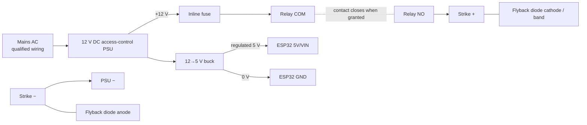

# Wiring Guide — ESP32 DevKit V1 Door Controller

Read this fully before applying power. The controller has two separate power
areas:

1. **Logic side:** 5 V/3.3 V for ESP32 and sensors.
2. **Lock side:** fused 12 V for the electric strike.

Never power the strike from the ESP32, USB port, or breadboard rails.

## Pin-by-pin low-voltage wiring

### MFRC522 reader (SPI)

The MFRC522 header label `SDA` means SPI chip-select in this wiring; it is not the
I2C SDA signal.

| MFRC522 | ESP32 DevKit V1 | Plain-language purpose |
|---|---|---|
| 3.3V | 3V3 | Reader power; **3.3 V only** |
| GND | GND | Common zero volts |
| RST | GPIO16 | Reset signal |
| SDA / SS | GPIO17 | Selects this SPI device |
| SCK | GPIO18 | Data clock |
| MISO | GPIO19 | Data from reader to ESP32 |
| MOSI | GPIO23 | Data from ESP32 to reader |
| IRQ | Not connected | Not used by this firmware |

Keep these wires short (ideally under 20 cm). Mount the antenna away from metal;
metal immediately behind it greatly reduces read range.

### FC-51 inside hand-wave/proximity sensor (cheapest option)

| FC-51 | ESP32 | Purpose |
|---|---|---|
| VCC | 3V3 | Use 3.3 V so its digital output is ESP32-safe |
| GND | GND | Common ground |
| OUT | GPIO21 | Active-low close-hand signal |

Mount on the inside only. Turn its small potentiometer until it triggers only
when a hand is roughly 5–12 cm away. The firmware requires the signal to stay
active for 120 ms, then will not trigger again until the hand has been removed
for 700 ms. No RFID verification is performed for this inside exit action.

FC-51 is the cheapest workable choice, but reflective IR is affected by direct
sunlight and by very dark/shiny hands or objects. Fit a short black plastic hood,
keep it out of sunlight, and test at different times of day. If it false-triggers,
upgrade only this part to a VL53L0X ToF breakout.

### Door contact and optional exit button

Use normally-closed loops so a cut/disconnected wire looks abnormal/open.

| Device | Connection |
|---|---|
| Door contact COM | ESP32 GND |
| Door contact NC | GPIO32 (future; not currently installed) |
| NC exit button COM | ESP32 GND |
| NC exit button NC | GPIO13 (then set `EXIT_BUTTON_INSTALLED = true` in firmware) |

No external resistor is required for a short bench wire because firmware enables
the ESP32 pull-ups. For a long installed cable, add a 4.7–10 kΩ pull-up at the
controller, use twisted cable, and add appropriate transient/ESD protection.

With the door closed/aligned, the door input must read `LOW`. Opening the door or
cutting the wire makes it `HIGH`.

### Remote-unlock trigger board (optional, shares a pin with the exit reader)

`firmware_remote_unlock/` is a standalone board with no RFID reader — it only
polls Supabase for the dashboard's "Open door" button and pulses a pin. It
plugs into the entry ESP32's existing `REMOTE_EXIT_IN` input (GPIO4,
`INPUT_PULLDOWN`, active HIGH) — the same pin `firmware_exit_reader/` already
drives — so the entry ESP32 needs no firmware changes at all.

Two independent boards will end up driving that one pin, so each one's output
wire needs its own series diode (e.g. 1N4148, banded/cathode end toward the
entry ESP32) before they join at GPIO4. Without the diodes, one board idling
LOW would short out the other board's HIGH pulse, and could damage both:

| From | Through | To |
|---|---|---|
| Exit NodeMCU `EXIT_HANDSHAKE_OUT` (D1 / GPIO5) | 1N4148 anode → cathode | Entry ESP32 GPIO4 |
| Remote-unlock board `HANDSHAKE_OUT` (D1 / GPIO5) | 1N4148 anode → cathode | Entry ESP32 GPIO4 |
| Remote-unlock board GND | — | Entry ESP32 GND (shared reference) |

Either diode conducting pulls GPIO4 high momentarily; GPIO4's internal
pull-down keeps it low the rest of the time. Neither board can be pulled down
by the other's idle state, and neither GPIO output pin ever sees the other
board's voltage directly.

### LEDs

The resistor may go on either side of each LED, but it must be in series.

- GPIO25 → 220–330 Ω resistor → green LED long leg (anode); short leg → GND.
- GPIO26 → 220–330 Ω resistor → red LED long leg (anode); short leg → GND.

### Active buzzer through transistor

- GPIO33 → 1 kΩ resistor → BC547 base (actual soldered connection).
- 10 kΩ from base to GND keeps it off during boot.
- Transistor emitter → GND.
- Buzzer negative → transistor collector.
- Buzzer positive → its rated supply (usually 3.3 V or 5 V; check its label).
- If using an electromagnetic buzzer rather than a piezo module, place a small
  flyback diode across it too.

### Relay/lock-control input

- GPIO27 → 1 kΩ resistor → base of the second BC547.
- Second BC547 emitter → common GND.
- Second BC547 collector → relay-module `IN`.
- Optional 10 kΩ pull-up: relay-module `IN` → relay `VCC` (5 V).
- Relay/driver logic `VCC` → the voltage printed on its board.
- Relay/driver logic `GND` → ESP32 GND unless it is wired for genuine optical
  isolation according to its own diagram.
- The second BC547 safely translates the ESP32's 3.3 V signal for the installed
  active-low 5 V relay input; never connect 5 V directly to an ESP32 GPIO.

Before connecting the lock, flash the firmware and use a multimeter/relay LED to
verify that reset and `LOCKED` do not energize the unlock path. Change
`LOCK_OUTPUT_ACTIVE_HIGH` in `main.cpp` if necessary.

## 12 V fail-secure strike power wiring

This diagram assumes a **12 V DC fail-secure strike** that unlocks when powered.
Do not reuse it for a maglock, AC strike, or motor lock.

Relay terminals:

- `COM` gets fused +12 V.
- `NO` goes to strike positive, so the default unpowered condition is locked.
- Strike negative returns to 12 V PSU negative.
- The flyback diode sits physically near the strike: banded end to strike
  positive, unbanded end to negative.

If using a MOSFET driver, follow that board's low-side/high-side diagram and
ensure its continuous current, surge current, voltage, diode, and thermal ratings
exceed the lock specifications.

## Door-contact mounting in simple terms

1. Close and latch the door naturally; do not hold it in an artificial position.
2. Temporarily tape the switch half to the fixed frame and magnet half to the door.
3. Keep their marked faces parallel. Start with a 3–8 mm gap, then follow the
   exact contact's rated make/break distance.
4. Watch `door_closed=true/false` in the ESP32 serial output while opening,
   closing, pushing, and pulling the latched door.
5. Confirm it reads closed despite normal door play, but open after the door moves
   a small meaningful amount.
6. Only then mark/drill. Use an adjustable spacer/bracket instead of forcing
   perfect surfaces.
7. Adjust the hydraulic closer so the latch reliably completes without slamming.

## Layout and interference rules

- Put the PSU, fuse, relay/driver, and ESP32 in a locked enclosure on the secure
  side.
- Route RFID/proximity/contact cables separately from lock current and mains wiring.
- Twist the lock pair and contact pair. Add a cable gland/strain relief.
- Keep Wi-Fi antenna and RFID antenna clear of the metal enclosure; use a plastic
  reader enclosure or a correctly designed external antenna arrangement.
- Do not use loose Dupont jumpers or a solderless breadboard in the final door.
- Only a qualified person should terminate mains input and fire-alarm interfaces.
